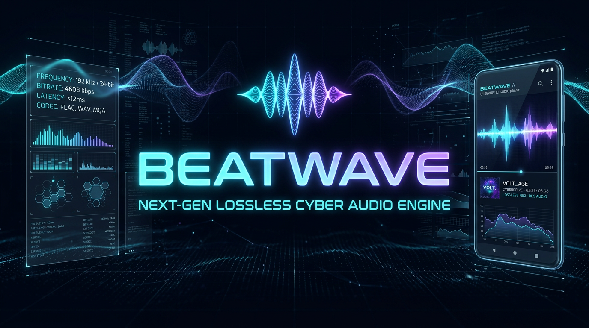

# BeatWave — Cyber Acoustic Edition

<p align="center">
  
</p>

<p align="center">
  
</p>

**BeatWave** is a high-performance Cyber-Tech & Material 3 Expressive Android music streaming and audio laboratory application crafted by **`mokka coding`** (`@dark.shadow_4531`).

---

## Highlighted BeatWave Cyber Modules

- **Cyber Sound Lab & 432 Hz Tuner**: Real-time procedural 44.1 kHz PCM synthesizer (`AudioTrack`) generating Binaural Alpha 10 Hz focus waves, Neon Rain, Deep Space Drone, and Vinyl Crackle alongside live 432 Hz natural tuning, Slowed + Reverb, and Nightcore harmonic pitch DSP.
- **Listener Identity & Telemetry Hub (`ProfileScreen`)**: Dedicated Cyber-Tech Profile dashboard featuring editable listener callsign & bio, live YouTube Music account sync status, real-time Room DB listening telemetry (total plays, unique tracks, playlists, offline vault storage), acoustic rank progression, **Settings & App Customization** hub, and **About BeatWave** portal at the bottom.
- **High-Animation Cyber About Page (`AboutScreen`)**: Custom `Orbitron`, `Rajdhani`, and `Share Tech Mono` typography, vector iconography, highlighted Cyber Modules, **`mokka coding`** circular creator portrait, **`@dark.shadow_4531`** Instagram card (featuring both the creator's Instagram DP and vector Instagram emblem), and hardware-accelerated `LMEB.gif` animation at the bottom.
- **One-Time First-Launch Cyber Onboarding (`CyberWelcomeDialog`)**: Immersive Cyber-Tech welcome experience displayed strictly on the very first launch after installation and persisted so it never interrupts subsequent launches.
- **Bit-Perfect Hi-Res Engine & Synced Lyrics**: Up to 24-bit / 192 kHz FLAC lossless playback, USB DAC Direct mode, AutoEQ parametric presets, word-synced Apple/TTML lyrics, offline encrypted/FLAC vault, and synchronized BeatWave Jam rooms.

---

## Creator

- **Architect & Developer**: `mokka coding`
- **Instagram**: [`@dark.shadow_4531`](https://www.instagram.com/dark.shadow_4531?stkn=MTZua29kbXpoOGhnMA==)
- **Repository**: [`keerthan4531-a11y/beat-wave`](https://github.com/keerthan4531-a11y/beat-wave)

---

## Build & Install on Android Phone

### 1. Build Release APK Locally
```bash
./gradlew assembleRelease
```

### 2. Install Directly to Connected Phone via ADB
Enable **Developer Options -> USB Debugging** on your Android phone, connect via USB, and run:
```bash
adb install -r BeatWave-v1.11.0-release.apk
```
*(Note: If you previously had an older signature installed under `com.lastwave.app`, run `adb uninstall com.lastwave.app` once before installing.)*
